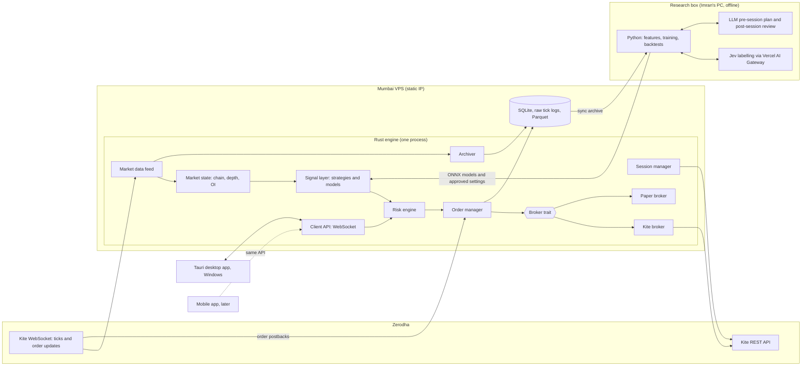

# ExpiryScalping - App Plan

Status: draft for review (2026-10-30)
Owner: Imran

This is the master plan for ExpiryScalping. It says what we are building, why, how the parts fit together, and in what order we build them. Working rules for anyone coding on the repo are in `docs/instructions.md`. What is built right now is in `docs/currentstate.md`. What changed and when is in `docs/changelog.md`.

---

## 1. Overview

ExpiryScalping is a personal, AI-assisted trading app for Indian index options, built on Zerodha Kite Connect v3 (https://kite.trade/docs/connect/v3/).

It does one thing: scalp index options on expiry day, automatically, inside hard risk limits that Imran sets.

Product goals, in priority order:

1. **Safe.** No signal, model or bug can get past the risk engine. A kill switch flattens everything and halts.
2. **Superfast.** Low latency from tick to order. The hot path is compiled Rust with no garbage collector and no network calls to AI services.
3. **Super lightweight.** Small server, small desktop app (around 10 MB), small storage footprint.
4. **Modern and beautiful.** A dark, minimal desktop app that shows what matters at a glance.

The core principle:

> The in-engine AI trades autonomously, fast and deterministically, and Imran can step in at any time. Slower AI (Jev and the LLM) makes it smarter offline and through approved settings. Nothing, AI or manual, is ever allowed to skip the risk engine.

---

## 2. Goals and non-goals

### Goals

- Trade expiry day index options (Nifty weekly on NSE, Sensex weekly on BSE) with autonomous AI entries and exits.
- Manual intervention at any time from the app: edit or modify AI orders, place trades, exit positions, or pause the AI.
- Start with under Rs 1 lakh of capital.
- Paper trading on live ticks first. Live trading is an explicit opt-in.
- Archive every expiry day's ticks and option chain from day one, so we build our own history.
- One client-agnostic engine API, so the Windows desktop app now and a mobile app later use the same server.
- Use Jev offline to label historical expiry day data, and an LLM for pre-session planning and post-session review.

### Non-goals (for now)

- No multi-user or multi-account support. This is Imran's personal tool.
- No non-expiry swing or positional trading.
- No stocks, futures or commodities in v1 (the data model should not block them later).
- No LLM or Jev on the live trading path, ever.
- No automated Zerodha login (no scripted password or TOTP entry). Imran logs in once a day through Kite's official flow.
- No order rate above the SEBI retail algo threshold (see section 4), so no exchange strategy registration is needed.
- No public web dashboard. The engine is reached only by Imran's own clients.

---

## 3. Market facts the engine depends on

All of these are **config values, not code constants**. The engine reads lot sizes, expiry dates and freeze quantities from the daily Kite instrument master wherever possible, and falls back to config. Values below were checked on 2026-10-30.

| Fact | Value | Source |
|---|---|---|
| Expiry days | Each exchange uses either Tuesday or Thursday for all equity derivatives, and keeps only one weekly benchmark index option | SEBI circular on expiry days, May 2025: https://www.sebi.gov.in/sebi_data/attachdocs/may-2025/1748266377271.pdf |
| NSE weekly | Nifty 50 weekly options expire on **Tuesday** (contracts expiring from 1 Sep 2025) | NSE circular FAOP68747: https://archives.nseindia.com/content/circulars/FAOP68747.pdf |
| BSE weekly | Sensex weekly options expire on **Thursday** (contracts expiring after 1 Sep 2025) | BSE notice 20250623-59: https://www.bseindia.com/markets/MarketInfo/DispNewNoticesCirculars.aspx?page=20250623-59 |
| Other index options | Bank Nifty, FinNifty and others are monthly only (last Tuesday on NSE) | Same SEBI and NSE circulars |
| Nifty lot size | **65** (from the 6 Jan 2026 weekly expiry; was 75) | NSE circular FAOP70616: https://nsearchives.nseindia.com/content/circulars/FAOP70616.pdf |
| Sensex lot size | **20** today; **25** for contracts expiring January 2027 onwards (notice effective 30 Oct 2026). Nov and Dec 2026 contracts stay at 20 | BSE notice 20260930-58, summarised by Zerodha: https://zerodha.com/marketintel/bulletin/460276/revision-in-market-lot-of-derivative-contracts-on-indices-from-october-30-2026 |
| Trading hours | 09:15 to 15:30 IST for index options | BSE contract specification page; NSE standard F&O hours |
| Holiday shifts | When expiry day is a holiday, expiry moves to the previous trading day | Exchange practice. The engine trusts the `expiry` field in the instrument master, not the weekday |

Rule: **the engine detects "today is expiry day" from the instrument master (`expiry == today`) for the configured underlyings.** It never assumes a weekday. Lot size comes from the instrument's `lot_size` field. This makes lot size revisions and holiday shifts a non-event.

---

## 4. Regulatory and broker constraints

### SEBI retail algo framework

- Framework: SEBI circular "Safer participation of retail investors in Algorithmic trading", 4 Feb 2025 (https://www.sebi.gov.in/sebi_data/attachdocs/feb-2025/1738665456458.pdf). Fully applicable to all brokers from **1 April 2026** (SEBI extension circular, Sep 2025: https://www.sebi.gov.in/sebi_data/attachdocs/sep-2025/1759232056254.pdf).
- **Static IP is mandatory for API order placement.** It is whitelisted in the Kite developer console (Profile, IP Whitelist). A primary IP is required, a secondary is optional, and it can be changed at most once per calendar week. WebSocket data and read APIs work from any IP. (Zerodha: https://support.zerodha.com/category/trading-and-markets/general-kite/kite-api/articles/static-ip)
- **Order rate threshold:** up to 10 orders per second per exchange needs no strategy registration. We stay far below that with our own rate cap (section 9). (NSE circular INVG67858: https://archives.nseindia.com/content/circulars/INVG67858.pdf)
- Algo order tagging with the exchange ID is done by the broker. We add our own `tag` for traceability.

### Kite Connect limits (from https://kite.trade/docs/connect/v3/exceptions/)

| Limit | Value |
|---|---|
| Order placement | 10 requests per second, 400 orders per minute |
| Orders per day | 5,000 per user or API key, across all segments |
| Modifications | 25 per order, then cancel and re-place |
| Quote API | 1 request per second |
| Historical candles | 3 requests per second |
| All other endpoints | 10 requests per second |
| WebSocket | 3,000 instruments per connection, 3 connections per API key |

### Kite session rules (from https://kite.trade/docs/connect/v3/user/ and the intro page)

- The `access_token` expires at **6 AM the next day** (regulatory), or earlier on logout or a master logout from Kite web.
- Kite APIs are **not CORS-enabled**, and for desktop and mobile apps "there has to be a remote backend" that does the token exchange. The `api_secret` lives only on the server.
- Token exchange: `request_token` from the login redirect, plus checksum `SHA-256(api_key + request_token + api_secret)`, POSTed to the token API.

### Kite Connect pricing (from Zerodha support, checked 2026-10-30)

- **Personal (free):** orders, GTT, portfolio. No live or historical data.
- **Connect, Rs 500 per app per month:** adds WebSocket market data and historical candles. **We need this plan.**
- From October 2026, users with Rs 2,000 or more of brokerage in a calendar month get 500 developer credits, covering the next month's renewal.
- Source: https://support.zerodha.com/category/trading-and-markets/general-kite/kite-api/articles/what-are-the-charges-for-kite-apis

---

## 5. Architecture



Key boundaries:

- **The only path to Zerodha's order API is Signal to Risk to Order manager to Broker.** The client API, the research box and any AI output can only change settings, and settings changes are validated by the risk engine too.
- **Research is offline.** It reads archived data and ships model files and setting proposals. It never connects to the live engine's order path.
- **Clients only watch and control.** The desktop app never talks to Zerodha directly, except opening Kite's login page in the browser.

### Why a Mumbai VPS

- Zerodha's API and the NSE are in Mumbai. A Mumbai server reaches them in roughly 1 to 3 ms. A home connection elsewhere in India typically adds 20 to 50 ms plus Wi-Fi and ISP jitter. (Rough estimates, to be measured in Phase 2.)
- SEBI requires a whitelisted static IP for API orders. Cloud servers give one easily, most home broadband does not.
- Uptime. The engine keeps running if Imran's laptop sleeps, the Wi-Fi drops or the power goes, which matters when it holds open positions.

---

## 6. Repository layout

```text
expiryscalping/
├── docs/
│   ├── plan.md            this file
│   ├── instructions.md    working rules for humans and AI
│   ├── currentstate.md    what is built now, what is next
│   └── changelog.md       what changed, when, verified how
├── engine/                Rust cargo workspace
│   ├── crates/
│   │   ├── es-core/       shared types: instruments, ticks, orders, money, time
│   │   ├── es-kite/       Kite REST client, auth, binary tick parser
│   │   ├── es-feed/       WebSocket connection manager, subscriptions
│   │   ├── es-market/     market state: option chain, depth, OI, IV
│   │   ├── es-strategy/   Strategy trait, rule strategies, model loading
│   │   ├── es-risk/       risk engine and limits
│   │   ├── es-oms/        order manager, order state machine
│   │   ├── es-broker/     Broker trait, Kite broker, paper broker
│   │   ├── es-archiver/   raw tick logs, Parquet conversion, instrument master
│   │   ├── es-api/        client WebSocket API and message types
│   │   └── es-replay/     replay and synthetic tick sources
│   └── bin/esd/           the engine binary (wires everything)
├── app/                   Tauri 2 + Svelte desktop app
├── research/              Python: features, training, backtests, Jev, LLM review
├── deploy/                systemd unit, setup script, firewall notes
└── .github/workflows/     CI
```

Module rule (same idea as the teacher repo's "no business logic in widgets"): **no trading logic in the API layer or the UI.** Crates depend inward on `es-core`. `es-risk` depends on nothing but `es-core`, so it stays small and fully testable.

---

## 7. Engine modules and interfaces

Interfaces below are sketches to fix the shape. Exact signatures are decided in code with tests.

### 7.1 Session manager (`es-kite::auth`)

- Holds `api_key` and `access_token`. Reads `api_secret` from the server's secret file, never from clients.
- Login flow:
  1. Desktop app asks the engine for the Kite login URL and opens it in the default browser.
  2. Imran logs in on Zerodha's page. Kite redirects to the registered redirect URL with `request_token`.
  3. The redirect URL points to a small local listener in the desktop app (for example `http://127.0.0.1:<port>/kite/callback`), which forwards `request_token` to the engine over the authenticated client API. (Whether Kite accepts a loopback redirect URL is to be confirmed in Phase 2. Fallback: an HTTPS callback path on the VPS behind the same auth.)
  4. The engine computes the checksum with `api_secret`, exchanges the token, and stores `access_token` in memory and an encrypted state file.
- Expiry handling: tokens die at 6 AM. Any `TokenException` (HTTP 403) moves the engine to `NeedsLogin`: new entries stop at once, the risk engine switches to exit-only mode, and the desktop app shows a "Log in to Kite" banner. Paper mode keeps running on replay data if the feed is down.
- No scripted credential or TOTP entry.

### 7.2 Market data feed (`es-kite::ticker`, `es-feed`)

- One persistent WebSocket to Kite per purpose, up to the limit of 3. v1 uses one connection: underlying indices plus the option chain around ATM (for example ATM plus or minus 10 strikes, both CE and PE, configurable).
- Hand-written zero-copy binary parser:
  - Modes: `ltp` (8 bytes), `quote` (44 bytes), `full` (184 bytes, includes 5-level depth: 5 bids and 5 offers).
  - Index packets use their own shorter structure and are parsed separately.
  - 1-byte heartbeats are ignored but update a "last seen" timer.
  - Text frames are JSON: order postbacks (`order` updates) go to the order manager, errors and messages go to the log.
- Subscriptions move with ATM. When the underlying moves a strike, the feed subscribes to new strikes before unsubscribing old ones.
- Reconnect with backoff and jitter. On reconnect, resubscribe and mark market state as stale until fresh ticks arrive. Strategies get no new entry signals on stale data.
- Every tick is stamped with a local receive time (monotonic clock, nanoseconds) for latency tracking and replay.

```rust
pub struct Tick {
    pub token: u32,
    pub ltp: Paise,            // integer money, never f64
    pub ltq: u32,
    pub volume: u64,
    pub oi: u64,
    pub depth: Option<Depth5>,
    pub exchange_ts: i64,
    pub recv_ns: u64,
}
```

### 7.3 Market state (`es-market`)

- Per underlying: spot, futures (if subscribed), option chain keyed by strike and type, 5-level depth, OI and OI change, rolling windows for momentum, implied volatility per strike (computed in the engine), and order book imbalance.
- Single writer (the hot thread), so no locks on the hot path.
- Exposes a read-only `MarketView` to strategies and a throttled snapshot (for example 5 to 10 per second) to the client API, so the UI can never slow the engine.

### 7.4 Signal layer (`es-strategy`)

```rust
pub trait Strategy: Send {
    fn id(&self) -> &'static str;
    fn on_tick(&mut self, view: &MarketView, tick: &Tick, out: &mut Vec<Signal>);
    fn on_fill(&mut self, fill: &Fill);
    fn on_timer(&mut self, now: Instant, out: &mut Vec<Signal>);
}

pub struct Signal {
    pub strategy: &'static str,
    pub instrument: u32,
    pub side: Side,
    pub intent: Intent,          // Enter, Exit, ReduceTo(qty)
    pub qty_lots: u32,
    pub limit: Option<Paise>,
    pub confidence: f32,
    pub reason: ReasonCode,      // compact, logged with the order
}
```

- **v1:** rule-based expiry day scalpers (for example momentum breakout on ATM or slightly OTM options, with fixed target, stop and time stop).
- **v2:** trained gradient boosted tree models (LightGBM) on features such as price momentum, OI change, IV change and order book imbalance, exported to ONNX and loaded with a lightweight runtime (`tract`, pure Rust, preferred for size; `ort` if we need speed or coverage). Target inference time: tens of microseconds.
- Models are versioned files with a manifest (feature list, training window, metrics). The engine refuses a model whose feature list does not match.
- Strategies emit signals only. They never call the broker.

### 7.5 Risk engine (`es-risk`)

See section 9 for the rules. Interface:

```rust
pub enum RiskDecision {
    Approve(OrderRequest),
    Resize(OrderRequest, RejectReason), // smaller qty that fits the limits
    Reject(RejectReason),
}

pub trait RiskCheck {
    fn check(&mut self, signal: &Signal, book: &PortfolioView, now: Instant) -> RiskDecision;
}
```

- Pure, synchronous, allocation-free on the hot path, under 5 microseconds per check.
- The only constructor of `OrderRequest` is inside `es-risk`, so other code cannot build an order that skipped it (enforced by Rust visibility).

### 7.6 Order manager (`es-oms`)

- Owns every order's lifecycle as a state machine:

```text
Created -> Sent -> Open -> (PartiallyFilled) -> Complete
                 \-> Rejected
          Open -> ModifyPending -> Open
          Open -> CancelPending -> Cancelled
          Sent -> Unknown (timeout) -> reconciled from order book
```

- Uses order postbacks from the WebSocket as the main source of truth, with a REST order book reconcile on reconnect, on timeout and every N seconds when orders are open.
- Enforces Kite limits on its side too: token-bucket rate limiter below 10 per second and 400 per minute, day counter below 5,000, modification counter per order (cancel and re-place after 25).
- Order defaults:
  - **Marketable LIMIT orders** by default (limit at the opposite best price plus a small buffer) to control slippage.
  - If a MARKET order is used (for example by the kill switch), always set `market_protection` (`-1` for automatic, or a configured percentage).
  - `autoslice` is supported for quantities above the freeze limit. With under Rs 1 lakh we will not reach freeze quantity, so it stays off by default.
  - Every order gets a `tag` (alphanumeric, max 20 characters), for example `ES` + strategy code + sequence, to link fills back to signals.
  - Product `MIS` (intraday) by default, so the broker squares off if everything else fails. Configurable to `NRML`.
- Exit orders are never blocked by entry limits.

### 7.7 Broker trait, Kite broker and paper broker (`es-broker`)

```rust
#[async_trait]
pub trait Broker: Send + Sync {
    async fn place(&self, req: OrderRequest) -> Result<BrokerOrderId, BrokerError>;
    async fn modify(&self, id: &BrokerOrderId, m: Modify) -> Result<(), BrokerError>;
    async fn cancel(&self, id: &BrokerOrderId) -> Result<(), BrokerError>;
    async fn orders(&self) -> Result<Vec<BrokerOrder>, BrokerError>;
    async fn positions(&self) -> Result<Vec<Position>, BrokerError>;
    async fn margins(&self) -> Result<Margins, BrokerError>;
}
```

- **Kite broker:** keep-alive HTTPS connection pool (rustls), pre-warmed at market open, so placing an order does not pay a TLS handshake.
- **Paper broker:** same trait, same order manager, same risk engine. Fills are simulated on live (or replayed) ticks:
  - Fill at the opposite side of the 5-level depth, walking the levels for size, plus configurable slippage.
  - Configurable simulated latency (for example 5 to 30 ms).
  - Partial fills when depth is thin.
  - Charges model (brokerage, STT, exchange charges, GST, stamp duty) from a config table, so paper P&L is net of costs.
- Mode is per engine session: `Paper` (default) or `Live`. Switching to `Live` requires Kite logged in, risk limits set, and an explicit confirm in the desktop app. Every switch is written to the audit log.

### 7.8 Archiver (`es-archiver`)

Kite's instrument master only returns tokens for live contracts. **Expired option contracts cannot be fetched later** ("It is not possible to retrieve instrument_tokens for expired contracts from the API, unless you regularly download and cache them", https://kite.trade/docs/connect/v3/historical/). So we archive from day one:

- **Daily instrument master** (`/instruments` CSV dump), every trading day before open, stored gzip compressed.
- **Expiry day full ticks** for the underlying and the whole near-ATM option chain, in `full` mode. Also non-expiry days at lower priority, if storage allows.
- **Option chain snapshots** once a minute (LTP, OI, depth top, IV) for a wider strike range.
- **Historical candles** backfill for live contracts at 1-minute with OI, respecting 3 requests per second, run after market hours.
- **Orders, fills, signals and risk decisions** for every session (paper and live), for research and review.

The archiver runs on its own thread with a bounded channel. If it falls behind, it drops archive writes and raises an alert. It never blocks the hot path.

### 7.9 Storage (lightweight by design)

| Data | Format | Why |
|---|---|---|
| Raw ticks (during market hours) | Append-only binary log per day: the original Kite frames plus our receive timestamp, zstd compressed after close | Fastest possible write, no parsing cost, and replay goes through the **same parser** as live, so backtests test the real code |
| Ticks and snapshots (after close) | Parquet files partitioned by `date/underlying` | Columnar and compressed (a few GB per month at most), read directly by Python (pandas, polars) and DuckDB |
| Analytics and research queries | DuckDB over the Parquet files | No server to run, fast SQL over columnar files, works on the VPS and on Imran's PC |
| Engine state: orders, fills, positions, settings, audit log | SQLite (WAL mode) | Single-file, transactional, crash-safe, tiny |

No database server (no Postgres, no TimescaleDB, no InfluxDB). That keeps the VPS small and backups simple: copy files.

Backups: nightly `rsync` (or object storage upload) of the day's archive and the SQLite file. Research syncs the Parquet tree down to Imran's PC.

### 7.10 Client API (`es-api`)

One WebSocket API for every client (desktop now, mobile later). No client-specific endpoints.

- Transport: WebSocket over TLS. JSON messages in v1 (easy to debug). MessagePack later only if profiling shows it matters.
- Auth: a long random device token per client, sent in the first message, compared in constant time. Tokens are created and revoked on the server (CLI command). Each device has a name in the audit log.
- Network exposure: see section 12 (WireGuard first).
- Message types are defined once in Rust and exported to TypeScript (for example with `ts-rs` or `typeshare`), so the app and engine cannot drift.

| Direction | Message | Purpose |
|---|---|---|
| Server to client | `status` | engine health, Kite session state, feed latency, mode (paper or live) |
| Server to client | `chain` | throttled option chain snapshot around ATM |
| Server to client | `positions`, `pnl` | positions and realised and unrealised P&L |
| Server to client | `orders`, `fills` | order log and updates |
| Server to client | `risk` | current limits, usage against limits, last rejections |
| Server to client | `alert` | errors, kill switch events, stale data |
| Client to server | `subscribe` | choose streams |
| Client to server | `set_strategy` | enable or disable a strategy |
| Client to server | `set_mode` | paper or live (with confirm token) |
| Client to server | `set_risk` | update limits (validated, audited) |
| Client to server | `kill` | kill switch |
| Client to server | `kite_login_url`, `kite_request_token` | Kite login flow |

Commands always get an `ack` or `error` reply with a request ID.

### 7.11 Threading model

- **Feed thread(s):** socket read and tick parsing.
- **Hot thread:** market state update, strategies, risk, order manager decisions. Single-threaded, no locks, pinned to a core where the VPS allows.
- **IO runtime (tokio):** broker HTTP calls, client API, timers.
- **Archiver thread:** writes logs and files.
- Threads talk over bounded lock-free channels (for example `crossbeam`).

### 7.12 Latency budget and measurement

| Stage | Target |
|---|---|
| Tick frame received to parsed | under 10 µs |
| Parsed to strategy signal | under 50 µs (rules), under 100 µs (model) |
| Risk check | under 5 µs |
| Order request to HTTP request on the wire | under 200 µs |
| Network to Kite from Mumbai | about 1 to 3 ms (estimate, measure) |

Every order carries timestamps for each stage. The desktop app shows p50 and p99 for the session. Zerodha's own OMS and exchange time is outside our control and is measured, not assumed.

---

## 8. Data flow

### Live (or paper) trading day

```text
06:00  Old Kite token expired
08:30  Engine downloads instrument master, finds today's expiries, builds the chain universe
08:45  Imran logs in to Kite from the desktop app, engine gets access_token
09:00  Pre-session plan (LLM, optional) is ready as a proposal; Imran approves or ignores it
09:10  Feed connects, subscribes indices + near-ATM chain, archiver starts raw log
09:15  Market opens; strategies warm up (no entries for a configurable first N minutes)
       tick -> market state -> strategy -> signal -> risk -> order manager -> broker
       postback -> order manager -> positions -> P&L -> client API
15:xx  Trading window ends (configurable, for example 15:10); exit-only mode; flatten by cut-off
15:30  Market closes; archiver closes the raw log
16:00  Convert to Parquet, backfill candles, back up, build the session report
Later  Post-session review (LLM) on Imran's PC, suggestions saved as proposals
```

### Research loop (offline)

```text
Archive (Parquet) -> feature building (Python) -> Jev labels (batch) -> label spot-check
  -> train models -> replay backtest through the real engine (es-replay)
  -> metrics report -> Imran approves -> model file + manifest deployed to the engine
```

---

## 9. Risk rules

The risk engine sits between every signal and the broker. It **cannot be disabled** by config, API or code path. All limits are set by Imran in the desktop app and stored in SQLite with an audit trail. Suggested starting defaults for Rs 1 lakh are shown, to be set by Imran.

| Rule | Behaviour | Suggested default |
|---|---|---|
| Daily max loss | Realised plus unrealised P&L at or below the limit triggers the kill switch for the rest of the day | Rs 2,000 |
| Per-trade max premium | Premium times quantity per entry may not exceed this. Larger signals are resized down or rejected | Rs 15,000 |
| Per-trade max size | Max lots per entry, per underlying | 1 lot |
| Max open positions | Max concurrent open positions across all strategies | 2 |
| Max trades per day | Entries per day | 20 |
| Order rate cap | Our own cap, well below Kite's 10 per second and SEBI's 10 OPS threshold | 2 orders per second, 60 per minute |
| Trading time window | Entries only inside the window. Exit-only after it. Flatten by the cut-off | Entries 09:20 to 15:00, flatten by 15:15 |
| Expiry-day only | Entries only on instruments expiring today, for configured underlyings | On |
| Stale data guard | No entries if the instrument's last tick is older than N ms or the feed is reconnecting | 1,500 ms |
| Spread guard | No entries if bid-ask spread is wider than X% of premium | 2% |
| Consecutive loss pause | After N losing trades in a row, pause entries for M minutes | 3 losses, 15 min |
| Margin check | Required margin must fit available funds from the last margin fetch | On |
| Kill switch | Cancels all open orders, flattens all positions (marketable limit, then market with protection), disables all strategies, blocks new entries until Imran re-arms it the next day or manually | Always on |

Rules about rules:

- Exits are always allowed, even when an entry rule is breached.
- Limit changes during market hours can only make limits **tighter** unless the engine is flat and Imran confirms.
- The kill switch is reachable from the desktop app (one big button), from a server CLI command, and automatically from the daily loss rule. A future mobile app gets the same button.
- If the engine loses contact with all clients for too long while live with open positions, it keeps managing exits on its own (it does not need the UI). Optional setting: flatten if no client heartbeat for N minutes.
- Every risk decision (approve, resize, reject with reason) is logged.

---

## 10. AI layers

The app is autonomous AI trading with manual override. Live trading decisions come from the in-engine models, within risk limits, and Imran can intervene at any time. Jev and the LLM work offline and through approved settings, since network calls are too slow for live order decisions.

### (a) Fast in-engine models (the live trader)

- Rules plus gradient boosted trees on momentum, OI change, IV and order book imbalance features.
- Deterministic: the same input gives the same output, which makes replay and debugging possible.
- Run in microseconds inside the hot thread.

### (b) Jev, offline research analyst

- Model: `typesafe-ai/jev-1.14.0` on Vercel AI Gateway. TypeSafe AI's evaluation model that "evaluates shared state against typed questions and returns choices, scores, and boolean probabilities", with multiple questions per request, 32,000 token context, priced at $0.042 per 1M input tokens (https://vercel.com/ai-gateway/models/jev-1.14.0, checked 2026-10-30).
- Use: batch through archived expiry day snapshots (for example one compact text state per minute or per event) and answer typed questions such as:
  - "Was this a trend day or a pinned day?" (choice)
  - "Did ATM OI unwinding come before a breakout in the next 10 minutes?" (boolean probability)
  - "How strong was the gamma move in this window?" (score)
- Output becomes labels and features for training models in (a).
- Quality control: hand-check a random sample (for example 5% of labels or at least 100 per question) against what actually happened in the data. Questions whose labels agree poorly are dropped or rewritten. Labels are stored with the model version and prompt version.
- Runs from `research/` on Imran's PC (or any machine), using a Vercel AI Gateway key from an environment variable. The engine has no Jev client.

### (c) LLM, pre-session planner and post-session reviewer

- **Before the session:** reads recent sessions, prior expiry days and optional notes, and proposes which strategies to enable and which risk settings suit the day.
- **After the session:** reviews every trade with its signal reason and risk decision, explains what worked and what did not, and proposes changes.
- Output is a typed proposal (JSON validated against a schema, the same "validate, parse, then use" rule as the teacher repo). Proposals show up in the desktop app and do nothing until Imran approves them. Approved changes still pass the risk engine's validation.
- The LLM has no tools that can place, modify or cancel orders.

---

## 11. Error handling

### Kite exceptions and HTTP codes (https://kite.trade/docs/connect/v3/exceptions/)

| Kite error | HTTP | Engine response |
|---|---|---|
| `TokenException` | 403 | Session expired or invalidated. Go to `NeedsLogin`, stop entries, exit-only, alert Imran |
| `InputException` | 400 | Bug or bad parameters. Reject the order, log full request (no secrets), alert. Do not retry |
| `OrderException` | 400/500 | Order placement failed. Do not blindly retry entries. Exits retry with a fresh price |
| `MarginException` | 400 | Insufficient funds. Reject entry, refresh margins, pause entries for that strategy |
| `HoldingException` | 400 | Should not occur for options buying. Reject and alert |
| `NetworkException` | 502/503/504 | OMS unreachable. Order state is unknown: mark `Unknown`, reconcile from the order book before any retry |
| `DataException` | 500 | Same as `NetworkException`, reconcile first |
| `GeneralException` | 500 | Log and alert. Entries paused briefly |
| (rate limit) | 429 | Back off. Our own limiter should prevent this; a 429 is logged as a bug |
| (not found / method / gone) | 404/405/410 | Bug. Log and alert |

Principles:

- **Never double-place.** An order with unknown state is reconciled (by `tag` and order book) before any retry.
- **Exits are more important than entries.** Exit retries are allowed with fresh prices and escalate to market with protection. Entry retries are not automatic.
- **Fail flat.** When in doubt (feed lost, session lost, state mismatch), stop entries and manage exits.

### Engine error types

`FeedDisconnected`, `StaleData`, `SessionExpired`, `BrokerRejected`, `BrokerUnknownState`, `RiskRejected`, `RateLimited`, `ConfigError`, `ArchiverBehind`, `ModelLoadFailed`. User-facing messages are short and actionable ("Kite session expired. Log in to resume entries."), with no stack traces in the UI.

### Logging

- Structured logs (`tracing` crate, JSON lines), one file per day, rotated.
- Log: startup, session changes, feed connect and disconnect, every order and state change, every risk decision, every error, latency stats.
- Never log: `api_secret`, `access_token`, device tokens, API keys for AI services.

---

## 12. Security

- **Secrets only on the server.** `api_secret`, `access_token`, device tokens and the AI gateway key never enter the repo or the desktop app bundle. Server secrets live in a root-readable file (for example `/etc/expiryscalping/secrets.toml`, mode 600) or systemd credentials. `.env`, `*.toml` secrets and key files are in `.gitignore`.
- **Static IP.** The VPS has a static public IP, whitelisted in the Kite developer console (primary). A secondary IP can be added for failover. IP changes are limited to once a week, so plan migrations.
- **Network exposure.** Preferred: the client API listens only on a WireGuard interface (or Tailscale), so nothing trading-related is on the public internet. The desktop app connects through the tunnel. Fallback if a tunnel is not practical: TLS (rustls or a Caddy reverse proxy) plus device token, plus IP allow-listing.
- **Server hardening.** SSH keys only, no password login, firewall (ufw) allowing only SSH and WireGuard, automatic security updates, engine runs as an unprivileged user under systemd.
- **Desktop app.** Stores only the engine URL and its device token, in the Windows Credential Manager (through Tauri's secure storage plugin), not in plain files.
- **Audit log.** Mode switches, risk limit changes, kill switch use, logins and device connections are recorded in SQLite with a timestamp and device name.
- **Dependencies.** `cargo audit` and `npm audit` in CI.

---

## 13. Desktop app (Tauri 2 + Svelte)

- Windows first (Imran is on Windows). Tauri 2 keeps the installer around 10 MB and also builds iOS and Android later.
- Dark, minimal and beautiful. Monospace numbers, green and red used only for P&L and direction, no clutter. Smooth at 60 fps with throttled updates.
- The app is a thin client: no trading logic, no Kite calls.

Screens:

1. **Engine status:** connection to engine, Kite session (with "Log in to Kite"), feed health and latency, mode badge (PAPER or LIVE, impossible to miss), today's expiry underlyings.
2. **Watchlist and option chain:** index cards (Nifty, Sensex) and an option chain around ATM with LTP, change, OI, OI change, IV and spread, ATM highlighted.
3. **Positions and P&L:** open positions, realised and unrealised P&L, net of charges, a small intraday P&L curve.
4. **Order log:** every order with tag, strategy, reason, status, fill price, slippage and latency.
5. **Strategies and mode:** strategy on and off toggles, paper or live switch with a confirm step.
6. **Risk settings:** all limits from section 9, with live usage bars ("Rs 800 of Rs 2,000 daily loss used").
7. **Kill switch:** a large, always-visible button on every screen, with a hold-to-confirm or a second click to prevent accidents.
8. **Proposals (Phase 5):** LLM suggestions with approve and reject.

Every screen handles loading, empty, error and disconnected states (teacher repo's definition of done).

---

## 14. Research (`research/`, Python, offline)

- Python 3.12, `uv` for environments, `polars` or `pandas`, `duckdb`, `lightgbm`, `onnxmltools` (or `hummingbird-ml`) for export, `pytest`, `ruff`.
- Contents: archive sync script, feature builders (must match the engine's feature code; a parity test compares Python and Rust features on the same replay), Jev labelling jobs, training scripts, model manifests, backtest reports, LLM review scripts.
- Rule: research never holds Kite order credentials and has no order code.

---

## 15. Testing strategy

| Area | Tests |
|---|---|
| Tick parser | Golden binary fixtures for every packet type (ltp, quote, full, index, heartbeat, multi-packet frames), truncated and corrupt frames, fuzz tests (`cargo fuzz`) so bad input never panics |
| Risk rules | Unit test per rule and per boundary (exactly at limit, one paisa over), property tests (`proptest`) that no sequence of signals can exceed limits, test that exits always pass, kill switch behaviour |
| Order state machine | Every transition, out-of-order postbacks, duplicate postbacks, timeouts to `Unknown` and reconcile, partial fills, 25-modification rule |
| Paper broker | Fill at depth, partial fills, slippage and latency settings, charges math against hand-calculated examples |
| Rate limiter | Never exceeds configured per-second and per-minute caps under burst |
| Session | `TokenException` moves to `NeedsLogin` and exit-only |
| Replay backtests | Recorded raw tick logs replayed through the real engine with the paper broker. Same input gives byte-identical order logs (determinism test) |
| Client API | Message schema round trip Rust to TypeScript, auth rejects bad tokens |
| Desktop app | Component tests (Vitest) for screens and states, one end-to-end smoke test against a replaying engine |
| Research | Feature parity test (Python vs Rust), label spot-check report |

CI (GitHub Actions): `cargo fmt --check`, `cargo clippy -- -D warnings`, `cargo test`, app lint and tests, research lint and tests, `cargo audit`. Live trading code is never exercised against real Kite in CI.

---

## 16. Deployment

- **VPS:** small Linux server in Mumbai, 2 vCPU, 2 to 4 GB RAM, static IP, Ubuntu LTS. Candidates: AWS Lightsail Mumbai, Vultr Mumbai, Akamai (Linode) Mumbai, or an Indian host such as E2E Networks. (Note: DigitalOcean's Indian region is Bangalore, not Mumbai.) Pick after a latency test to Kite's API from each.
- **Engine:** single static binary built in CI (or cross-compiled), copied to the server, run under systemd with restart on failure. Config in TOML, secrets in a separate root-owned file.
- **Clock:** `chrony` for accurate time, since trading windows and latency stats depend on it.
- **Releases:** semantic versions, tags `vX.Y.Z` matching changelog headings. Desktop app built by a GitHub Actions release workflow (Windows installer).
- **Before every live day:** the engine runs a self-check (clock, disk, Kite session, instrument master, risk limits loaded) and refuses live mode if any fails.

---

## 17. Cost estimate (monthly)

| Item | Cost | Status |
|---|---|---|
| Kite Connect (paid plan, needed for WebSocket and historical data) | Rs 500 per app, or covered by developer credits with Rs 2,000+ brokerage in the previous month | Verified on Zerodha support, 2026-10-30 |
| Mumbai VPS with static IP | about Rs 500 to 1,500 | Estimate, verify |
| Extra storage or backups | about Rs 100 to 300 at first | Estimate, verify |
| Jev labelling and LLM review | a few hundred rupees | Estimate, depends on volume |
| Research and training | Rs 0 (Imran's PC) | |

Realistic total: about Rs 1,000 to 2,500 per month on top of the Kite subscription. Brokerage and statutory charges on trades are separate.

---

## 18. Roadmap

Each phase is a set of vertical slices. Each slice is implemented, tested, logged in the changelog, committed and pushed before the next one starts (see section 19).

### Phase 0 - Repo and docs setup

- `docs/plan.md`, `docs/instructions.md`, `docs/currentstate.md`, `docs/changelog.md`.
- Repo skeleton (`engine/`, `app/`, `research/`, `deploy/`), `.gitignore`, README, CI running format, lint and tests on empty crates.
- **Milestone:** CI green on `main`, docs approved by Imran.

### Phase 1 - Engine core, paper trading and desktop app on simulated and replayed ticks

- `es-core` types, synthetic tick source (index random walk plus a simulated option chain with OI and depth), replay source format.
- Market state, Strategy trait with one simple rule strategy, risk engine with all section 9 rules, order manager state machine, paper broker.
- Client API with device token auth.
- Tauri app: status, chain, positions and P&L, order log, strategy toggles, risk settings, kill switch.
- **Milestone:** Imran runs the engine locally, opens the desktop app, watches a simulated expiry day trade on paper, changes limits, and hits the kill switch. Risk and state machine tests complete.

### Phase 2 - Real Kite feed, session and archiver

- Kite login flow, session manager, binary tick parser on real data, subscriptions that follow ATM, order postbacks.
- Archiver: daily instrument master, raw tick logs, Parquet conversion, candle backfill, backups.
- Deploy to the Mumbai VPS, static IP whitelisted, WireGuard access, latency measured.
- Paper trading on live ticks every expiry day.
- **Milestone:** two full weeks of expiry days archived without gaps, paper trading running on live data, measured latency report.
- Note: every expiry day not archived is lost for good. The archiver could be pulled forward and deployed right after the tick parser works, even before the rest of Phase 2. Decision for Imran.

### Phase 3 - Live trading with tiny size

- Kite broker behind the Broker trait, order reconcile, error handling from section 11, pre-live self-check, live mode confirm.
- Start with 1 lot, the tightest limits, and one strategy.
- **Milestone:** a set number of live expiry days (for example 8) with no risk rule breach and no unreconciled order, and live results reviewed against paper results for the same days.

### Phase 4 - Research, ML and Jev labelling

- Archive sync, feature builders with Rust parity test, Jev labelling jobs with spot-check reports, LightGBM training, ONNX export, model loading in the engine, replay backtests.
- **Milestone:** a trained model beats the rule strategy in replay on held-out expiry days, net of charges, and is deployed to paper first.

### Phase 5 - LLM pre-session plan and post-session review

- Session report builder, LLM review and plan scripts, typed proposals, approve and reject in the desktop app.
- **Milestone:** a review is produced automatically after every expiry day and at least one approved proposal has gone through the full flow.

### Phase 6 - Mobile app

- Tauri 2 mobile build (Android first, then iOS) against the same client API: status, P&L, positions, kill switch, alerts.
- **Milestone:** Imran can watch the session and hit the kill switch from his phone.

---

## 19. Workflow (from Imran's teacher repo conventions)

Full rules are in `docs/instructions.md`. In short:

- **The repository is the source of truth.** Every session starts with `git status`, `git log`, and reading `docs/currentstate.md` and `docs/changelog.md`.
- **Small vertical increments.** One meaningful increment at a time: implement, test, lint, update `changelog.md` (and `currentstate.md`), commit, push, verify. Never batch several features into one commit or defer pushes.
- **Changelog in the same commit** as the work, with date, summary, Added, Changed, Fixed, Verification and Git sections. Release headings carry the version and a short title.
- **Conventional commits** with a scope, for example `feat(risk): daily max loss rule`, `fix(feed): resubscribe after reconnect`.
- **No AI attribution in commits.** No "Co-authored-by" or similar trailers about any AI.
- **Done means pushed.** Implemented, tested, changelog updated, committed, pushed and verified. If a push is blocked, say so plainly with the reason.
- **No destructive git** (force push, hard reset, history rewrite) without Imran's explicit permission.

---

## 20. Open questions

1. Pull the archiver forward to start recording expiry days as early as possible? (Recommended.)
2. Which VPS provider, after the latency test?
3. WireGuard or Tailscale for engine access?
4. Starting risk defaults in section 9: confirm or change.
5. First rule strategy for Phase 1: confirm the momentum breakout idea or describe your own setup.
